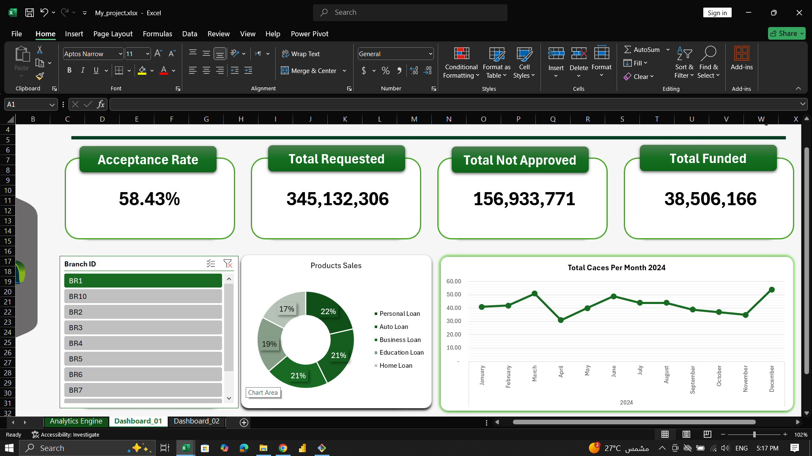
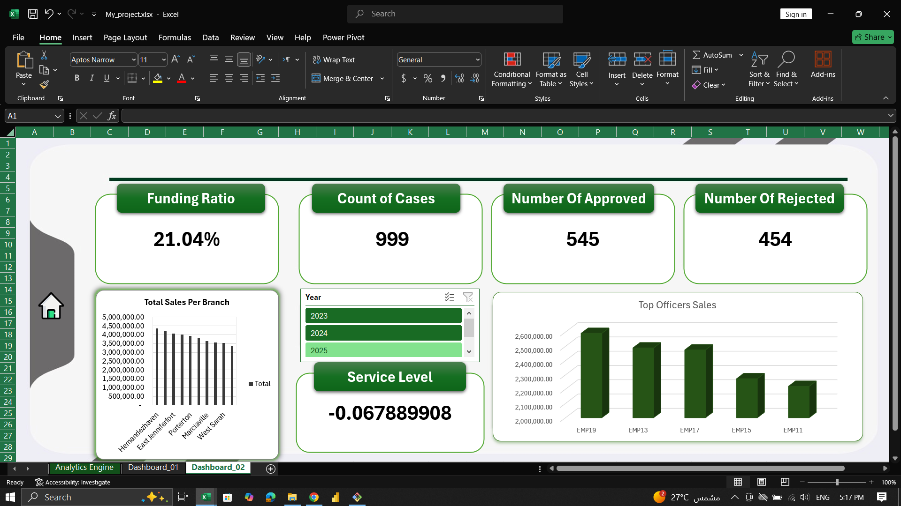
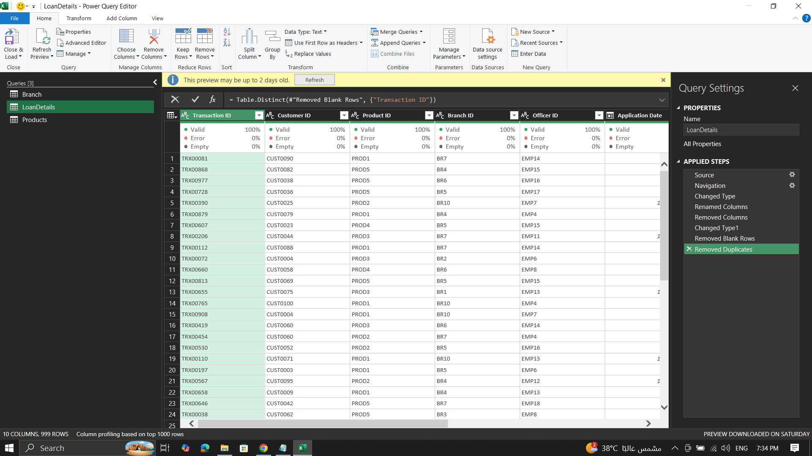
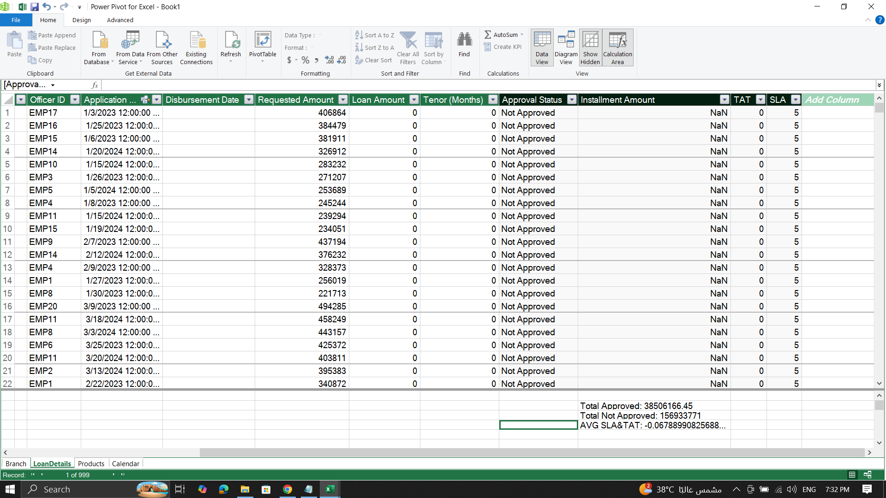
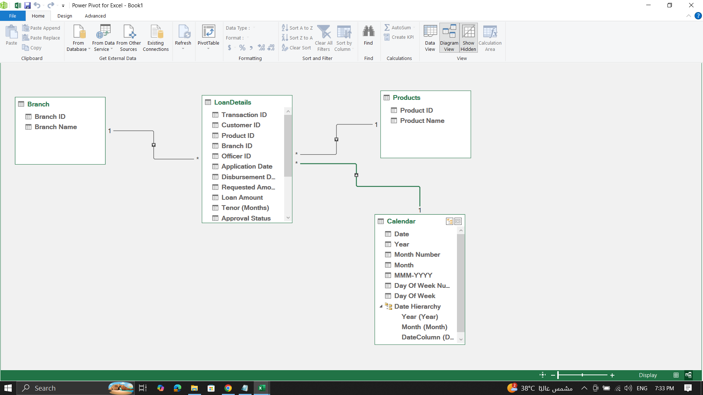
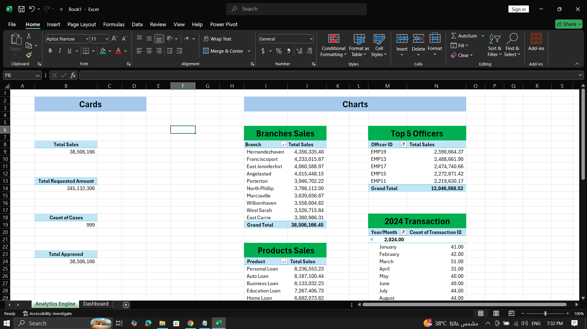

# Bank Loan Analytics Dashboard (Excel)


An interactive Excel dashboard for a bank's loan portfolio (2023–2025), built with **Power Query, Power Pivot (Data Model) and DAX**. It tracks loan requests, approvals, funding, branches, loan officers and products.



## Business questions

1. How much money do customers request, and how much is approved and funded?
2. What share of loan applications is accepted?
3. Which loan products are most in demand?
4. Which branches and loan officers bring the most business?
5. How does the number of cases change during the year?

## Key numbers

| KPI | Value |
|---|---|
| Total requested | **345.13M** |
| Not approved | 156.93M (about 45% of requested) |
| Total funded | 38.51M |
| Acceptance rate | **58.4%** |
| Loan cases | 999 (545 approved, 454 rejected) |
| Funding ratio | 21.0% |

## Insights

- **Almost half of the requested money is not approved** (156.9M of 345.1M).
- **Demand is spread across products**: personal loans have the largest share (22%), and no product is below 17%.
- **Cases peak in December 2024** (more than 50 cases) and are lowest in April.
- **Five officers stand out** (EMP19, EMP13, EMP17, EMP15, EMP11), each with more than 2.2M in loans.

## Recommendations

- Analyse why applications are rejected (amount, product, branch) to find requests that could be approved with changes.
- Plan staff and credit reviews ahead of the December peak.
- Share the top officers' practices with the lower-performing branches.

## Dashboard pages

| Overview | Branches & officers |
|---|---|
|  |  |

Slicers: Branch ID, Year.

## Process

| Power Query | DAX measures | Data model | Pivot tables |
|---|---|---|---|
|  |  |  |  |

1. **Power Query:** cleaned and transformed the loan tables.
2. **Power Pivot:** built a relational data model (loan details, customers, products, branches, officers).
3. **DAX:** measures for acceptance rate, funding ratio, total requested / funded / not approved, approved and rejected counts.
4. **Dashboard:** Pivot Tables and Pivot Charts with slicers, organised on two dashboard sheets.

## Files

```text
My_project.xlsx   full workbook (data model, Analytics Engine sheet, 2 dashboards)
images/           screenshots
```

---

**Ibrahim Shnouda** · [LinkedIn](https://linkedin.com/in/ibrahim-shenouda) · [GitHub](https://github.com/ibrahemshenouda)
