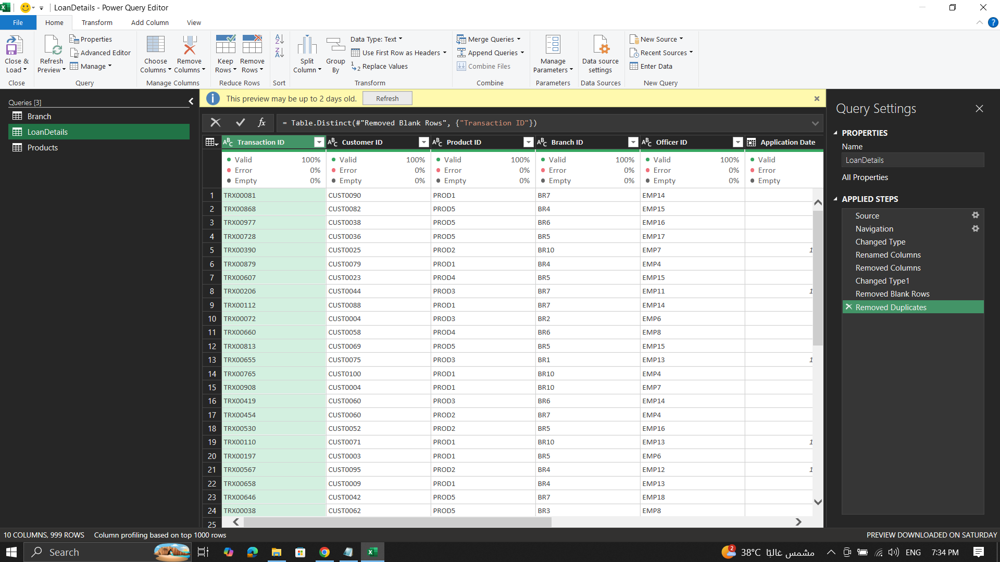
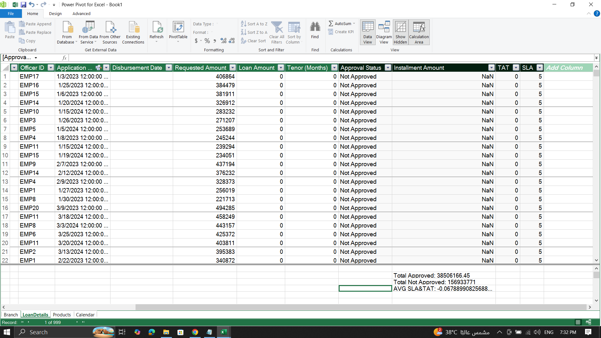
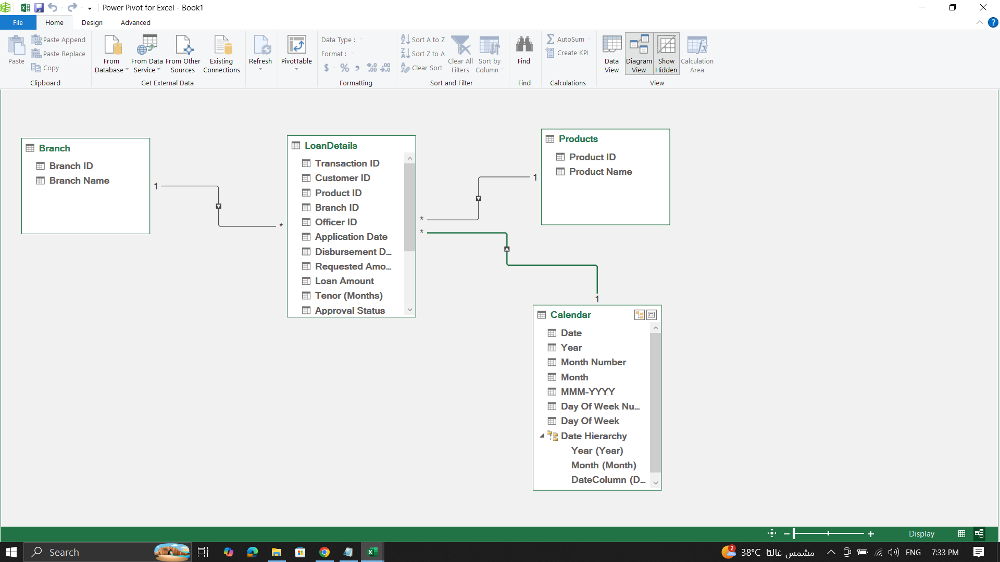
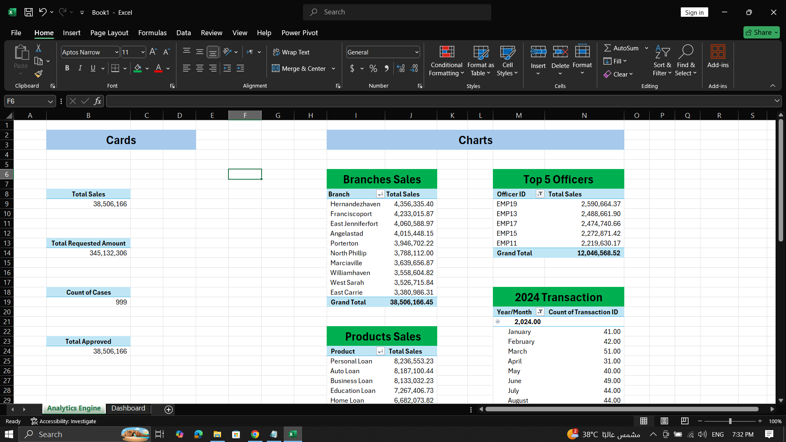
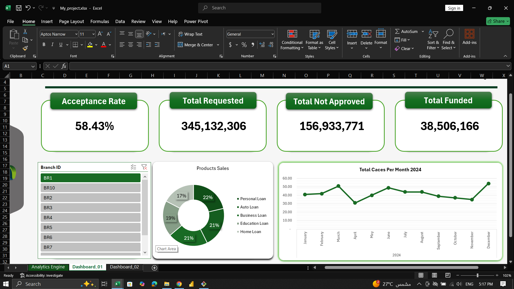
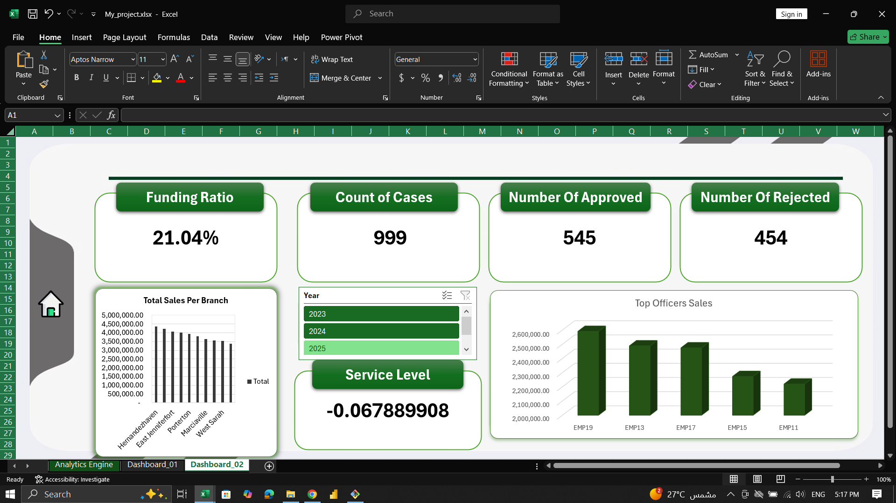

# Bank Loan Analytics Dashboard 📊

An Excel project that analyzes bank loan data and presents key business insights through an interactive dashboard.

## 🛠️ Tools Used
- Microsoft Excel
- Power Query
- Power Pivot & DAX
- Data Model
- Pivot Tables & Pivot Charts

## ⚙️ Project Workflow
1. Cleaned and transformed data using Power Query.
2. Built a relational Data Model using Power Pivot.
3. Created DAX measures for key performance indicators (KPIs).
4. Built Pivot Tables and Pivot Charts.
5. Designed an interactive dashboard to visualize loan analytics.

## 📸 Project Screenshots

### 1. Data Cleaning — Power Query

### 2. DAX Measures

### 3. Data Modeling

### 4. Pivot Tables

### 5. Dashboard

### 6. Dashboard — Additional View

## 📁 Project Files
- `My_project.xlsx` — Complete Excel workbook.
- Screenshots — Project workflow and dashboard views.

## 🎯 Key Skills
- Data Cleaning & Transformation
- Data Modeling
- DAX Measures
- Data Visualization
- Business Analysis

---
**Author:** [Ibrahem Shenouda](https://github.com/ibrahemshenouda)
